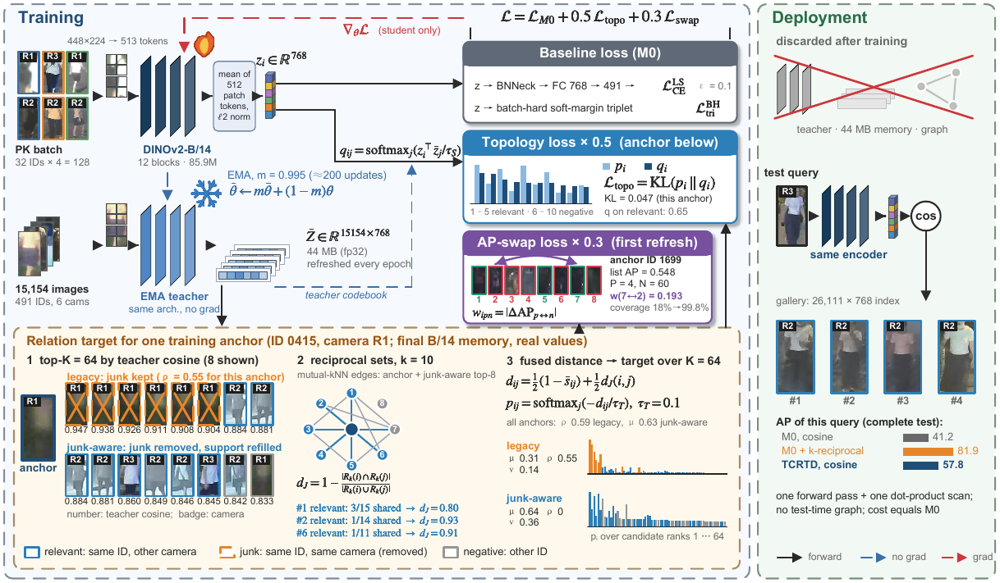

# Re-Ranking at Training Time: Topology-Consistent Relation Distillation (TCRTD)

Official implementation of

> **Re-Ranking at Training Time: Topology-Consistent Relation Distillation for Plain-Cosine Re-Identification**
> Yu Ding, Xiuhui Wang. *IEEE Transactions on Multimedia* (under review).
>
> Code maintained by Yu Ding (<24h034160211@cjlu.edu.cn>).

k-reciprocal re-ranking improves re-identification by asking whether two images also agree on
their neighbors, but it builds a graph over the gallery for every query. TCRTD moves this
computation to training time. An EMA teacher builds reciprocal-neighborhood targets over the full
training set, and the student learns them through a topology (KL) loss and an AP-swap loss whose
pair weights are exact AP changes. After training the teacher and graph are discarded: the deployed
model is the original encoder with plain cosine matching.



**Relation semantics.** A reciprocal target rewards same-identity, same-camera neighbors that the ReID
evaluator ignores. The *junk-aware* (evaluator-compatible) target removes them. For a fixed support,
removing junk mass &rho; changes the distillation force by exactly 2&rho; and raises the relevant mass from
&mu; to &mu;/(1&minus;&rho;) (Theorem 1 and Corollary 1 of the paper; both are checked numerically in `tests/`).

## Repository layout

```text
tcrtd/
  relation.py   EMA teacher memory, k-reciprocal graph, relation targets, topology KL, AP-swap loss
  model.py      DINOv2-S/14, B/14 and ResNet-50/101 backbones with a mean-token descriptor and BNNeck head
  losses.py     cross-entropy companions: soft/hard-margin batch-hard triplet, Smooth-AP
  data.py       image-folder datasets, camera parsing, PK sampler, transforms
  metrics.py    mAP / Rank-1 with the ReID junk rule, k-reciprocal re-ranking, identity-block bootstrap
train.py        M0, TCRTD, Smooth-AP, Smooth-AP + TCRTD
evaluate.py     plain-cosine evaluation; writes per-query AP for paired statistics
tools/          data preparation with content audit, paired bootstrap, fixed re-ranking
scripts/        commands that reproduce the DINOv2 and ResNet experiments
tests/          exactness of the AP-swap weights, Theorem 1 and Corollary 1, metric rules
```

## Installation

```bash
git clone https://github.com/trooty524/TCRTD.git && cd TCRTD
conda create -n tcrtd python=3.10 -y && conda activate tcrtd
pip install -r requirements.txt
```

Tested with Python 3.10, PyTorch 2.11 (CUDA 12.8), torchvision 0.26, and timm 1.0. Training needs one
CUDA GPU; DINOv2-B/14 with batch 128 at 448&times;224 uses about 25 GB (the DINOv2 experiments of the paper ran
on one NVIDIA RTX 4080 SUPER, 32 GB). Pretrained weights are downloaded
automatically (official DINOv2 checkpoints, torchvision ImageNet-1K V1 ResNets) unless `--weights`
points to a local file.

## Data

Every split is stored as `root/<identity>/<image>`. `tools/prepare_data.py` arranges the official
releases and removes training images whose bytes or decoded pixels equal a test image:

```bash
python tools/prepare_data.py --dataset market1501 --source /path/to/Market-1501-v15.09.15 --output data/market1501
python tools/prepare_data.py --dataset msmt17     --source /path/to/MSMT17_V1           --output data/msmt17
python tools/prepare_data.py --dataset nightreid  --source /path/to/NightReID           --output data/nightreid \
    --exclude-identities protocols/nightreid_excluded_identities.txt
```

| Dataset | Training identities / images | Test queries / gallery | Notes |
| --- | --- | --- | --- |
| Market-1501 | 751 / 12,936 | 3,368 / 19,732 | no overlap found |
| MSMT17 | 1,041 / 32,391 | 11,659 / 82,161 | 230 training duplicates of test images removed |
| NightReID | 491 / 15,154 | 1,394 / 26,111 | 9 identities excluded (test collisions, label conflicts) |

Evaluation follows the official rules: camera ids are parsed from the file names, a query's gallery
images of the same identity and camera are ignored, and Market-1501 junk images (identity `-1`) are
ignored; distractors (`0000`) remain negatives. Animal datasets have no camera labels: train with
`--sampler random --relation legacy` and evaluate with `--identity-only` (ATRW: `--all-vs-all`).

## Training and evaluation

```bash
# TCRTD, DINOv2-B/14, Market-1501 (6-epoch budget, last checkpoint)
python train.py --train-root data/market1501/train --output runs/market_b14_tcrtd \
    --backbone dinov2_b14 --objective tcrtd --epochs 6 --seed 13

python evaluate.py --checkpoint runs/market_b14_tcrtd/model.pth \
    --query-root data/market1501/test/query --gallery-root data/market1501/test/gallery \
    --output runs/market_b14_tcrtd/test
```

`--objective` selects `m0` (cross-entropy + triplet), `tcrtd`, `smooth_ap`, or `tcrtd_smooth_ap`.
`--relation {junk_aware,legacy,fixed_support}` and `--rank-policy {student_score,candidate_order}`
select the relation semantics; the defaults are the final configuration of the paper.

| Setting | Value |
| --- | --- |
| candidates K, reciprocal k | 64, 10 |
| raw / Jaccard fusion, temperatures | 0.5 / 0.5, 0.1 / 0.1 |
| EMA momentum | 0.995 |
| topology / swap weights | 0.5 / 0.3 (DINOv2); 1/50&ndash;1/25 of these for ResNet |
| DINOv2 budgets (epochs) | Market-1501 6, MSMT17 4, NightReID 6 (80-epoch cosine schedule) |

## Reproducing the paper

```bash
bash scripts/run_dinov2.sh   # main result, Smooth-AP combination, NightReID relation targets
bash scripts/run_resnet.sh   # ImageNet ResNet-50/101 study
python tools/paired_bootstrap.py --baseline runs/market1501/dinov2_b14/m0_s{13,42,2026}/test \
                                 --method   runs/market1501/dinov2_b14/tcrtd_s{13,42,2026}/test
```

Expected mAP (%) on the complete test sets, three-seed means:

| Dataset | Backbone | M0 | TCRTD | &Delta; [95% CI] | Smooth-AP + TCRTD |
| --- | --- | --- | --- | --- | --- |
| Market-1501 | DINOv2-S/14 | 82.55 | 84.13 | +1.58 [+1.34, +1.84] | 85.68 |
| Market-1501 | DINOv2-B/14 | 87.82 | 88.57 | +0.75 [+0.54, +0.96] | 89.39 |
| MSMT17 | DINOv2-S/14 | 58.66 | 61.08 | +2.43 [+2.26, +2.59] | 65.83 |
| MSMT17 | DINOv2-B/14 | 69.84 | 71.09 | +1.26 [+1.09, +1.42] | 72.19 |
| NightReID | DINOv2-S/14 | 35.95 | 36.91 | +0.96 [+0.49, +1.43] | 39.58 |
| NightReID | DINOv2-B/14 | 43.01 | 43.66 | +0.65 [+0.15, +1.14] | 46.03 |

Runs are seeded and use deterministic kernels where PyTorch provides them. Individual runs can still
differ slightly across GPUs and library versions; compare three-seed means and paired intervals.

## Tests

```bash
python -m pytest tests
```

## Citation

```bibtex
@article{ding2026tcrtd,
  title   = {Re-Ranking at Training Time: Topology-Consistent Relation Distillation for Plain-Cosine Re-Identification},
  author  = {Ding, Yu and Wang, Xiuhui},
  journal = {IEEE Transactions on Multimedia},
  note    = {under review},
  year    = {2026}
}
```

## License

Released under the MIT License (see `LICENSE`). Benchmark images are not redistributed; obtain them
from their official sources.
